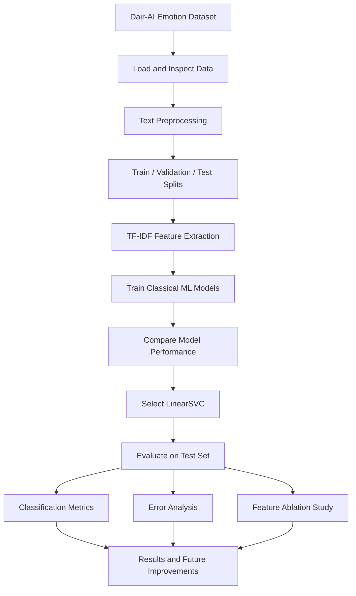

# 🎭 Emotion Detection Model

### Machine Learning & NLP-Based Text Emotion Classification

A machine learning project that analyzes text and classifies it into six emotion categories using Natural Language Processing (NLP), TF-IDF feature extraction, and classical machine learning algorithms.

The project uses the **Dair-AI Emotion dataset** and evaluates classification performance using accuracy, precision, recall, and Macro-F1 score. It also includes model comparison, feature ablation, interpretability examples, and error analysis to understand the strengths and limitations of text-based emotion classification.

<p align="center">
  <a href="https://www.python.org/">
    
  </a>
  <a href="https://scikit-learn.org/">
    
  </a>
  <a href="https://pandas.pydata.org/">
    
  </a>
  <a href="https://jupyter.org/">
    
  </a>
  <a href="https://huggingface.co/datasets/dair-ai/emotion">
    
  </a>
</p>

---

## 📌 Table of Contents

- [Overview](#-overview)
- [Project Objectives](#-project-objectives)
- [Key Features](#-key-features)
- [Dataset Description](#-dataset-description)
- [Technology Stack](#-technology-stack)
- [Project Workflow](#-project-workflow)
- [NLP and Feature Engineering](#-nlp-and-feature-engineering)
- [Model Details](#-model-details)
- [Model Evaluation and Results](#-model-evaluation-and-results)
- [Interpretability and Error Analysis](#-interpretability-and-error-analysis)
- [Ablation Study](#-ablation-study)
- [Repository Structure](#-repository-structure)
- [Installation and Setup](#-installation-and-setup)
- [Usage Guide](#-usage-guide)
- [Current Limitations](#-current-limitations)
- [Future Improvements](#-future-improvements)
- [References](#-references)
- [Author](#-author)
- [Disclaimer](#-disclaimer)

---

## 📘 Overview

Human emotions are often expressed through text in messages, online discussions, reviews, and social media posts. Understanding these emotions automatically can help analyze text at scale.

This project applies supervised machine learning and NLP techniques to identify the emotion expressed in a text sample. The text is transformed into numerical features using **TF-IDF (Term Frequency–Inverse Document Frequency)**, which allows a classifier to learn patterns associated with different emotion labels.

Multiple classical machine learning approaches are considered, with **Linear Support Vector Classification (LinearSVC)** identified as the best-performing classical model in the reported evaluation.

The project also examines class imbalance, feature selection through an ablation study, and errors involving short, ambiguous, mixed, or sarcastic expressions.

### 🎯 Problem Statement

Text can express different emotions using similar words, while the same phrase may communicate different feelings depending on its context. The objective is to develop and evaluate a model that predicts an emotion category from text while measuring its performance across all classes.

### 💡 Applications

- Emotion analysis of text messages
- Customer feedback and review analysis
- Social media text analytics
- Conversational text analysis
- NLP classification research
- Understanding emotion-related language patterns

These are potential applications; the project has not been established as a production deployment for these use cases.

---

## 🎯 Project Objectives

1. Process and represent text data for machine learning.
2. Convert text into numerical features using TF-IDF.
3. Train and compare classical machine learning classifiers.
4. Evaluate performance using accuracy and Macro-F1.
5. Examine performance differences across emotion categories.
6. Investigate whether adding bigram features improves classification.
7. Analyze misclassifications and identify areas for improvement.
8. Establish a foundation for more advanced NLP models.

---

## ✨ Key Features

| Feature | Description |
|---|---|
| Text emotion classification | Predicts one of six emotion categories from text. |
| NLP preprocessing | Prepares text for numerical feature extraction. |
| TF-IDF vectorization | Represents text using term importance. |
| Classical ML models | Compares traditional supervised learning approaches. |
| LinearSVC classifier | Best-performing classical model in the reported results. |
| Model evaluation | Uses accuracy and Macro-F1 to assess performance. |
| Class imbalance analysis | Examines the lower representation of the surprise class. |
| Feature ablation | Compares unigram-based and alternative feature configurations. |
| Interpretability examples | Highlights words associated with example emotion classes. |
| Error analysis | Examines difficulties involving sarcasm and ambiguous text. |

---

## 📊 Dataset Description

**Dataset:** [Dair-AI Emotion](https://huggingface.co/datasets/dair-ai/emotion)

The dataset contains labeled text samples intended for emotion classification.

| Attribute | Details |
|---|---|
| Dataset source | Dair-AI Emotion |
| Number of samples | 20,000 |
| Number of classes | 6 |
| Input | Text |
| Target | Emotion label |
| Least frequent class | Surprise |
| Surprise class proportion | Approximately 3.6% |

### Emotion Categories

The six categories are:

- **Sadness**
- **Joy**
- **Love**
- **Anger**
- **Fear**
- **Surprise**

The distribution is imbalanced, with surprise representing the smallest proportion of the dataset. This makes per-class evaluation important because overall accuracy alone may not reveal how well the model recognizes less frequent emotions.

*Dataset statistics above reflect the reported project results. The README does not independently establish the dataset's license, exact split sizes, or preprocessing details.*

---

## 🛠 Technology Stack

| Technology | Purpose |
|---|---|
| [Python](https://www.python.org/) | Core programming language |
| [scikit-learn](https://scikit-learn.org/) | Feature extraction, model training, and evaluation |
| [Pandas](https://pandas.pydata.org/) | Data handling and analysis |
| [NumPy](https://numpy.org/) | Numerical operations |
| [NLTK](https://www.nltk.org/) / [spaCy](https://spacy.io/) | NLP preprocessing options |
| [Jupyter Notebook](https://jupyter.org/) | Interactive experimentation and analysis |
| [Hugging Face Datasets](https://huggingface.co/docs/datasets/) | Dataset source and documentation |

The exact libraries used in the executed notebook should be confirmed from its imports and implementation.

---

## 🔄 Project Workflow



### Workflow Explanation

1. **Data loading:** Load the labeled emotion dataset and inspect its structure.
2. **Preprocessing:** Prepare the text for vectorization.
3. **Data splitting:** Separate the data into training, validation, and test sets.
4. **Feature extraction:** Convert text into TF-IDF numerical vectors.
5. **Model training:** Fit and compare classical machine learning classifiers.
6. **Model selection:** Select LinearSVC based on the reported evaluation.
7. **Testing:** Assess the selected model using the test set.
8. **Analysis:** Examine per-class behavior, feature variants, and misclassified examples.
9. **Reporting:** Summarize the results and identify further improvements.

---

## 🧠 NLP and Feature Engineering

### TF-IDF Vectorization

TF-IDF converts text into numerical features based on the importance of words within a document relative to the collection of documents.

It helps a classifier learn associations between textual patterns and emotion labels.

The vectorizer should be fitted on the training data only, then applied to validation and test data to avoid information leakage.

### Unigrams and Bigrams

- **Unigrams:** Individual tokens, such as `happy`, `angry`, or `afraid`.
- **Bigrams:** Consecutive pairs of tokens, such as `very happy` or `feel sad`.

The reported ablation study found that the unigram configuration was sufficient for this experiment and that adding bigrams did not improve Macro-F1.

---

## 🤖 Model Details

### Best Classical Model: LinearSVC

LinearSVC is a linear Support Vector Classification algorithm available in scikit-learn. It learns decision boundaries that separate classes in the numerical feature space.

It is suitable for sparse, high-dimensional text features such as TF-IDF vectors.

**Reported configuration:**

| Component | Details |
|---|---|
| Task | Multiclass text classification |
| Feature extraction | TF-IDF |
| Best model | LinearSVC |
| Target classes | Six emotions |
| Primary evaluation metric | Macro-F1 |
| Additional evaluation metric | Accuracy |

Logistic Regression and Naive Bayes are common baseline models for this type of task, but their exact configurations and individual scores should be taken from the notebook rather than inferred from the project description.

---

## 📈 Model Evaluation and Results

The following metrics are reported for the selected classical model.

| Metric | Validation | Test |
|---|---:|---:|
| Accuracy | 0.8840 | 0.8860 |
| Macro-F1 | 0.8433 | 0.8490 |

### Performance Summary

- **Test Accuracy:** 88.60%
- **Test Macro-F1:** 0.8490
- **Validation Accuracy:** 88.40%
- **Validation Macro-F1:** 0.8433

The reported test accuracy indicates that the classifier correctly predicts the emotion label for approximately 88.6% of test samples.

Macro-F1 gives equal weight to each class's F1 score, making it useful when emotion classes have different sample counts. The test Macro-F1 of 0.8490 provides a more balanced view of performance than accuracy alone.

These are the reported results for this experiment, not a guarantee of performance on new datasets or real-world text.

---

## 🔍 Interpretability and Error Analysis

### Example Emotion-Associated Terms

The project reports the following example terms associated with particular emotion classes:

| Emotion | Example terms |
|---|---|
| Anger | irritable, dangerous, petty |
| Fear | shaken, terrified, vulnerable |

These examples offer a qualitative view of language associated with the classes. They should not be interpreted as causal explanations of individual model predictions without additional feature-attribution analysis.

### Error Analysis

The reported analysis identifies several challenging cases:

- **Mixed emotions:** A sentence may express multiple emotions simultaneously.
- **Sarcasm:** Literal wording may conflict with the intended emotion.
- **Short text:** Brief utterances may not provide enough context.
- **Ambiguous expressions:** Similar phrases can communicate different emotions depending on the situation.

Understanding these errors can guide improvements in preprocessing, feature engineering, class handling, and model architecture.

---

## 🧪 Ablation Study

An ablation study compares model variants to determine whether a particular feature configuration improves results.

| Variant | Macro-F1 |
|---|---:|
| Variant A | 0.8470 |
| Variant B | 0.8433 |

The reported finding is that **unigrams were sufficient and bigrams did not help** in this experiment.

The exact mapping of Variant A and Variant B to their feature settings should be verified against the notebook before assigning each variant a specific configuration.

---

## 📁 Repository Structure

A suggested repository structure is shown below. Adjust the filenames to match the files actually uploaded to GitHub.

```text
emotion-detection-model/
│
├── notebooks/
│   └── emotion_detection.ipynb
│
├── data/
│   └── README.md
│
├── README.md
├── requirements.txt
└── .gitignore
```

### File Responsibilities

| File or Folder | Purpose |
|---|---|
| `notebooks/` | Contains the Jupyter Notebook for preprocessing, training, and evaluation |
| `data/` | Optional location for local datasets or dataset instructions |
| `README.md` | Project documentation |
| `requirements.txt` | Python dependencies |
| `.gitignore` | Excludes virtual environments, local datasets, caches, and generated artifacts |

The notebook filename and directory layout above are examples, not verified names of the existing repository files.

---

## 💻 Installation and Setup

### Prerequisites

Install Python and Jupyter from their official sources:

- [Python Downloads](https://www.python.org/downloads/)
- [Jupyter Installation Guide](https://docs.jupyter.org/en/latest/install.html)
- [scikit-learn Installation Guide](https://scikit-learn.org/stable/install.html)

### Step 1: Clone the Repository

Replace the sample URL with the actual repository URL if the repository has a different name.

```bash
git clone https://github.com/manojBhorge07/emotion-detection-model.git
cd emotion-detection-model
```

### Step 2: Create a Virtual Environment

**Windows:**

```powershell
python -m venv .venv
.venv\Scripts\Activate.ps1
```

**macOS / Linux:**

```bash
python3 -m venv .venv
source .venv/bin/activate
```

### Step 3: Install Dependencies

If the repository includes a `requirements.txt` file:

```bash
pip install -r requirements.txt
```

Otherwise, install the commonly used packages:

```bash
pip install numpy pandas scikit-learn jupyter
```

Install NLTK or spaCy only if required by the notebook's actual implementation.

### Step 4: Launch Jupyter Notebook

```bash
jupyter notebook
```

Open the project's notebook in your browser and run the cells in order.

### Step 5: Obtain the Dataset

Access the dataset from the [Dair-AI Emotion dataset page](https://huggingface.co/datasets/dair-ai/emotion) and follow the notebook's expected data-loading procedure.

Do not commit large dataset files or files subject to licensing restrictions without first checking the dataset's usage terms.

---

## ▶️ Usage Guide

1. Set up the Python environment and install dependencies.
2. Obtain the required dataset.
3. Open the Jupyter Notebook.
4. Execute the preprocessing and feature-extraction cells.
5. Train the supported classification models.
6. Review validation and test metrics.
7. Inspect the ablation study and error-analysis outputs.
8. Compare your results with the reported metrics.

Results may differ if the dataset version, data splits, random seed, vectorizer settings, or model hyperparameters differ.

---

## ⚠️ Current Limitations

1. **Class imbalance:** The surprise class accounts for approximately 3.6% of the dataset.
2. **Sarcasm and context:** TF-IDF features may not capture implied meanings or context reliably.
3. **Short utterances:** Limited text can make emotion classification ambiguous.
4. **Mixed emotions:** A single-label classifier may not represent multiple emotions expressed together.
5. **Domain generalization:** Performance on the dataset may not transfer directly to other domains.
6. **Interpretability:** Example terms alone do not fully explain model decisions.
7. **Reproducibility:** Exact package versions, split details, and model configurations should be recorded to reproduce results.

---

## 🚀 Future Improvements

- Apply class weighting or oversampling to address class imbalance.
- Improve handling of emojis, hashtags, slang, and informal text.
- Add domain-specific vocabulary and preprocessing.
- Experiment with transformer-based models fine-tuned on longer text sequences.
- Investigate probability calibration and confidence estimates.
- Add confusion matrices and detailed per-class precision, recall, and F1 reports.
- Evaluate generalization on external datasets.
- Add automated tests and a reproducible training pipeline.
- Save the fitted vectorizer and model for repeatable inference.
- Build an optional interface for classifying user-provided text.

---

## 📚 References

- [Dair-AI Emotion Dataset](https://huggingface.co/datasets/dair-ai/emotion)
- [scikit-learn Documentation](https://scikit-learn.org/stable/)
- [TF-IDF Vectorizer Documentation](https://scikit-learn.org/stable/modules/generated/sklearn.feature_extraction.text.TfidfVectorizer.html)
- [LinearSVC Documentation](https://scikit-learn.org/stable/modules/generated/sklearn.svm.LinearSVC.html)
- [NLTK Documentation](https://www.nltk.org/)
- [spaCy Documentation](https://spacy.io/)

---

## 👨‍💻 Author

**GitHub:** [manojBhorge07](https://github.com/manojBhorge07)

**LinkedIn:** [Connect on LinkedIn](https://in.linkedin.com/in/manoj-bhorge-630a81287)

---

## ⚖️ Disclaimer

This project is provided “as is,” without guarantees of accuracy or suitability for any particular purpose. Emotion predictions are estimates based on learned text patterns and should not be treated as definitive assessments of a person's feelings or mental state. Verify results independently before relying on them in consequential decisions.

---

<p align="center">
  <b>Built with Python, NLP, and Machine Learning.</b>
</p>
